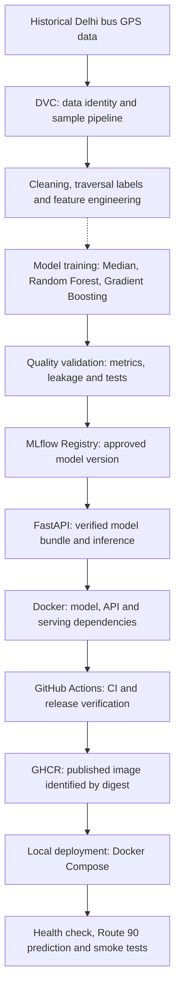

# AI-POWERED SUSTAINABLE TRANSPORTATION ADVISOR

## 1. Project Overview and Phase 2 Objectives

**Phase 2: From a trained bus travel-time model to a tested, versioned and deployable prediction service.**

Urban travelers must balance journey time, cost, service availability and environmental impact. Bus travel times are particularly variable because traffic, stops and operating conditions affect observed journeys. Our broader project proposes an advisor that will compare feasible multimodal journeys and explain these trade-offs.

Phase 2 develops one measurable foundation for that advisor: predicting **bus riding time across a defined road segment**, in minutes. Our team connects historical data preparation, model evaluation, version control, experiment tracking, an inference API and a local container deployment.

| Phase 2 demonstration | Broader project vision |
|---|---|
| A versioned Gradient Boosting model served through FastAPI and Docker | Multimodal journey planning across bus, metro, train, cab and walking |
| Approved historical Route 90 eastbound segment | Wider route and directional-segment coverage |
| Riding-time prediction and verified API behavior | Complete journey time, fares, estimated emissions and an interactive journey interface |

The demonstrated service is a **local historical-data application**. It does not yet calculate an entire itinerary or consume live traffic observations. Walking, waiting to board and transfers are outside this segment prediction.

## 2. End-to-End MLOps Architecture

MLOps connects a model with the data, evidence, software and operating environment needed to use it reliably. Our implementation follows this lifecycle:



**Diagram scope:** this is the logical model-to-service workflow. The solid data-processing steps are reproducible for the available daily sample. The dotted connection identifies a boundary: the approved model's historical 637-row training input is separate from that sample and is not currently available for a fresh complete reproduction. Training, release and local deployment are not one automatically triggered operation.

| Component | Purpose in our project | Main output |
|---|---|---|
| Python, pandas and SQLite | Read GPS observations and construct useful training examples | Cleaned segment traversals and features |
| DVC and Git | Identify data content and associate processing definitions with source code | Data pointers, pipeline stages and dependency/output hashes |
| scikit-learn | Train comparable regression models with fitted preprocessing | Candidate prediction pipelines |
| Quality checks and Pytest | Evaluate model suitability and verify software behavior | Quality reports and test results |
| MLflow | Record experiments and identify an approved numbered model | Run evidence, artifacts and registry version |
| FastAPI, Pydantic and Uvicorn | Validate requests and expose inference over HTTP | Readiness and prediction endpoints |
| Docker and Docker Compose | Package and run the service consistently | Container image and local service |
| GitHub Actions and GHCR | Automate checks and distribute a verified image | CI results, image publication and digest verification |

Each component answers a different question: **which data, which model, which evidence, which software environment, and which deployed image?**

## 3. Data Pipeline and Versioning Using DVC

### From GPS messages to travel-time labels

The source is the July 2019 Delhi bus GPS archive, stored as daily SQLite databases. The verified July 1 sample contains **1,977,922 observations**. A GPS message is not itself a travel-time label: a label requires observing a bus cross a segment's entry and exit boundaries.

Our processing normalizes fields, removes duplicate observations, rejects implausible GPS jumps and separates trajectories at large gaps. Direction-aware gate crossings estimate entry and exit times. Traversals with unsuitable gaps or durations are rejected.

The prediction target is:

```text
travel_time_minutes = (segment exit time - segment entry time) / 60
```

### Why DVC is used

Git is suitable for code and small configuration files; large databases and generated datasets belong outside ordinary Git history. **DVC stores a small reference containing a data fingerprint**, while the data can reside in local cache or the configured DagsHub-backed remote. A content hash helps identify whether an experiment uses the intended file.

| Data-versioning element | Actual project implementation |
|---|---|
| Raw tracked sample | `data/raw/2019-07-01.db` |
| Git-tracked pointer | `data/raw/2019-07-01.db.dvc` |
| Recorded raw-file MD5 | `e3c31e6255359b7a4ebf93b3154659b2` |
| Processing definitions | `dvc.yaml` and `dvc.lock` |
| Reproducible stages | `sample_labels` → `sample_features` |
| Verified daily-sample output | **152 traversals and corresponding cold-start feature rows** |

The stages write traversal/feature CSVs and lineage metadata recording raw-data identity, processing-source hashes, dependency-lock identity and output hashes. A repeated recorded DVC run skipped unchanged stages and reported the pipeline up to date. This avoids repeating processing unnecessarily.

**Reproducibility boundary:** the historical model used 637 traversals across five recorded dates. Original reports and source-data identities are available, but the complete multi-day input is not currently present. The 152-row sample pipeline must not be presented as a reconstruction of that 637-row experiment.

Implementation references: [DVC pipeline](../dvc.yaml), [raw-data pointer](../data/raw/2019-07-01.db.dvc) and [label construction](label_construction_report.md).

## 4. Model Development and Testing

### Models and feature preparation

We compare three approaches under the same historical split:

| Model | How it works | Why it is useful |
|---|---|---|
| Historical Median | Predicts the training-data median for each segment, with a global median fallback | Provides a simple, interpretable reference that an ML model should improve upon |
| Random Forest Regressor | Averages predictions from multiple randomized decision trees | Learns nonlinear relationships while reducing reliance on one tree |
| Gradient Boosting Regressor | Builds trees sequentially to reduce remaining prediction error | Captures structured interactions between segment, route and time features |

The implementation uses **scikit-learn Gradient Boosting**, not XGBoost. Tree pipelines include numerical imputation/scaling and categorical imputation/one-hot encoding. Preprocessing is fitted using training rows only.

The model receives 12 ordered features:

| Feature group | Inputs |
|---|---|
| Segment and route context | Segment ID, direction, string route ID, segment length |
| Time context | Entry hour, minute of day, sine/cosine daily-time representation, rush-hour category |
| History-policy fields | Segment-history duration, recent-history duration, completed-traversal count |

### Chronological evaluation

| Split | Recorded IST dates | Traversals | Purpose |
|---|---|---:|---|
| Training | July 1, 2 and 3, 2019 | 408 | Fit preprocessing and estimators |
| Validation | July 5, 2019 | 102 | Select the candidate by MAE |
| Test | July 8, 2019 | 127 | Assess the selected tree against the median |
| **Total** | Five historical dates | **637** | Recorded Phase 2 experiment |

Labels crossing a fitting/selection cutoff are excluded from that earlier period. This prevents a traversal's future completion from contributing an available training label too early.

**Reading the metrics:** MAE is average absolute error in minutes; RMSE penalizes large errors more strongly. Lower values are better for both. R² compares performance with a constant-mean reference: closer to 1 is better, and negative values are possible. These are regression metrics, not a classification accuracy percentage.

### Validation results — 102 traversals

| Model | MAE (min) | RMSE (min) | R² |
|---|---:|---:|---:|
| Historical Median | 3.2355 | 4.3689 | 0.0392 |
| Random Forest | 2.4924 | 3.7185 | 0.3040 |
| **Gradient Boosting** | **2.4739** | **3.6882** | **0.3152** |

Gradient Boosting has the lowest recorded validation MAE. Its advantage over Random Forest is small; the evidence supports selecting it for this demonstration, not claiming a large universal advantage.

### Overall test results — 127 traversals

| Model | MAE (min) | RMSE (min) | R² |
|---|---:|---:|---:|
| Historical Median | 4.2702 | 6.9353 | 0.0427 |
| **Selected Gradient Boosting** | **3.6226** | **6.3204** | **0.2050** |

Random Forest has validation results, but no final-test result in this approved comparison. The test stage evaluates the selected tree and baseline; no Random Forest test score is inferred.

### Approved Route 90 eastbound scope — 36 test traversals

| Model | MAE (min) | RMSE (min) | R² |
|---|---:|---:|---:|
| Historical Median | 1.3032 | 2.1280 | -0.1695 |
| **Gradient Boosting** | **1.1661** | **1.5992** | **0.3395** |

These 36 observations are a **subset of the 127 test traversals**. The supported-scope error must not be substituted for overall error. An MAE of 1.1661 minutes also does not mean every prediction is within that margin.

Pytest complements this statistical evaluation by checking feature consistency, chronological boundaries, artifact loading, API behavior and deployment recovery with deterministic fixtures. **Passing software tests and achieving low prediction error are different forms of evidence.**

Metric source: [original Phase 2 quality report](results/phase2-v1/quality_report.json). Values above are rounded to four decimal places; full-precision values remain in the report and original experiment outputs.

## 5. Model Quality, Risk and Approval

### Preventing leakage and inconsistent inputs

Data leakage occurs when a model receives information that would not be available when making the prediction. Our prediction moment is the bus's **segment entry time**. The feature contract excludes the target duration, exit time and completed-trip speed derived from the target.

Route IDs remain strings in both CSV loading and API requests. The same feature-engineering function is used for evaluation and serving, with the same column order. The API obtains direction and segment length from the catalog rather than trusting client-supplied values.

### Why `cold_start_v1` is used

There is no live completed-traversal history store in the demonstrated service. The named `cold_start_v1` policy therefore sets both history-duration fields to a deterministic nominal duration and the completed count to zero:

```text
history duration = (segment_length_km / 22 km/h) × 60 minutes
hist_completed_count = 0
```

This policy is used consistently during fitting, validation and inference. The two duration fields are **fallback feature values**, not measured recent traffic. The trained estimator still generates the final prediction.

### Approval checks

| Risk | Check used in the project |
|---|---|
| Wrong data or inconsistent evaluation | Verify input identity, chronological split metadata and recorded metrics |
| Training/serving mismatch | Check ordered features, route type, named history policy and compatible runtime |
| Weak candidate | Require the selected tree to improve on the median in validation/test and in the approved demo-scope MAE |
| Corrupt or different model | Verify artifact hashes and compare predictions after reloading |
| Invalid output | Require predictions to be finite and positive |
| Unsupported or malformed request | Return HTTP 422; do not silently extend coverage |
| Missing/unavailable inference | Return HTTP 503 in the source API; exercise failure cases in automated tests |

The original approval snapshot records **12 passing quality checks**. A recorded complete reproduction uses an expanded **16-check** gate and verifies the registered model against **127 held-out predictions**. Failed checks prevent approval; they do not justify inventing a fallback result or changing historical evidence.

The test dates are later than the fitting dates, but all observations are historical. Repeating evaluation on previously assessed 2019 data is a regression/reproducibility check, not a new independent test of present-day traffic accuracy.

## 6. MLflow Experiment Tracking and Model Registry

**MLflow Tracking records an experiment; MLflow Model Registry identifies a model intended for use.** Tracking answers how a candidate was evaluated. The registry links an approved numbered version to its run and stored artifact.

| Verified project detail | Value |
|---|---|
| Experiment | `BusTravelTime-ColdStart` |
| Tracked candidates | Historical Median, Random Forest, Gradient Boosting |
| Registered model | `BusTravelTimePredictor` |
| Approved version/status | **1 / READY** |
| Approved estimator | **Gradient Boosting Regressor** |
| Source run | `66c819ceb83740c18d05800213524441` |
| History policy | `cold_start_v1` |
| Validation MAE | **2.4739467045209045 minutes** |
| Overall test MAE | **3.6225757396594864 minutes** |

Runs contain parameters such as the history policy, random seed, date cutoffs and training-input hash, together with validation/test metrics. Artifacts include the selected Joblib pipeline, evaluation tables, quality evidence and dependency information. The registered MLflow model additionally contains `MLmodel`, `model.pkl`, its input signature and saved input examples.

The project uses **local SQLite-backed MLflow metadata and local artifact storage**. Verification of the recovered original registry confirmed that version 1 points to the expected run and that its model files are accessible through MLflow APIs. Loading `models:/BusTravelTimePredictor/1` successfully reproduced predictions.

| Verified input | Predicted duration | Interpretation |
|---|---:|---|
| Saved MLflow input example: time features represent 06:03 | 4.560981108546524 min | A different time-of-day input |
| Supported Route 90 request at 17:10 | 6.320402254818158 min | Matches the approved deployment example |

The registered pickle and original Joblib candidate agree on both inputs. The Joblib SHA-256 matches the approved serving artifact, linking **training run → registry version → exported model → deployed prediction**. Different serialization formats need not have identical file hashes; prediction parity checks the corresponding behavior.

The recovered model's core sklearn/NumPy/pandas versions were matched during verification; the full archived dependency set was not reproduced exactly. These observations establish compatibility for the checked inputs, not a fresh evaluation of all 127 rows. No shared/cloud MLflow registry operation is claimed.

Identity evidence: [approved registry snapshot](results/phase2-v1/registration.json). Original and recovered databases/artifacts remain local, outside Git.

## 7. FastAPI Model Serving

A REST API lets another application request a prediction without embedding the model inside its own code. **FastAPI** defines the HTTP endpoints and documentation; **Pydantic** validates request/response structures; **Uvicorn** runs the service.

| Endpoint | Purpose | Verified behavior |
|---|---|---|
| `GET /health` | Report whether the model bundle is loaded and valid | HTTP 200 with model identity; HTTP 503 while unavailable |
| `POST /predict/bus` | Estimate riding time for the approved route/segment | HTTP 200 with positive finite minutes, version and policy |
| `GET /docs` | Swagger UI for understanding and trying the API | Documented request/response contract; supported example executed successfully |

### Supported request

```json
{
  "segment_id": "ORR_CHIRAG_TO_NEHRU_PLACE_EB",
  "route_id": "90",
  "entry_at": "2019-07-08T17:10:00+05:30"
}
```

### Verified response

```json
{
  "duration_minutes": 6.320402254818158,
  "model_version": 1,
  "estimate_source": "model",
  "history_policy": "cold_start_v1"
}
```

For each request, the service validates string identifiers and a timezone-aware timestamp, checks approved coverage, resolves catalog information, converts time features to IST and constructs the shared 12-feature frame. The already-loaded pipeline then predicts the duration. Model loading occurs once during application startup, after checksum/schema checks.

Extra fields, invalid timestamps and unsupported combinations receive **422**. The source implementation also handles prediction exceptions, invalid output shapes and nonfinite/nonpositive durations with controlled **503** responses. Structured logs include request ID, approved scope, model identity, status and latency without recording request bodies or credential headers.

The Swagger example and structured behavior were verified with the actual v1 model in a separate source-built container. The published-image deployment was verified independently; it was not replaced by that temporary test instance.

**Meaning of the estimate:** this is a historical-pattern model prediction for a segment-entry time, not a live traffic feed or a complete journey-time estimate.

Implementation: [FastAPI service](../src/api/main.py) and [shared features](../src/features/build_features.py).

## 8. Docker Containerization

Docker packages the inference code, approved model and runtime dependencies into an image. This makes the service easier to move between compatible machines without relying on each machine's training environment.

| Packaging decision | Benefit |
|---|---|
| Pinned Python base and serving dependency lock | Makes the intended runtime explicit and testable |
| Joblib model plus identity/schema manifest in the image | Keeps inference tied to an approved artifact |
| Shared feature code included | Preserves request/evaluation feature preparation |
| Training/test tools and large raw datasets excluded | Keeps the serving image focused on inference |
| Built-in `/health` check | Lets Docker and Compose assess readiness |
| Non-root application user | Avoids unnecessary container privileges |

The serving model is bundled locally inside the image; each prediction does not require a running MLflow server or access to raw training data. Docker standardizes packaging, but compatibility is established by testing the image and its dependencies—not by assuming any model works in any container.

The published Linux/amd64 image is identified by its immutable digest in [the v1 deployment record](../deploy/model-v1.json). Recorded checks verified container health, approved model identity, real inference and dependency consistency. A separate local source build using the actual approved v1 artifact also became healthy and returned the same 17:10 prediction. This local build was a verification image, not a new GHCR publication.

Packaging definitions: [Dockerfile](../Dockerfile) and [serving lock](../requirements-serve.lock.txt).

## 9. CI/CD Using GitHub Actions

**Continuous Integration (CI)** automatically checks that the project still behaves correctly. **Continuous delivery** prepares verified artifacts for release; **continuous deployment** additionally automates rolling a release out to a running service. Our project automates testing and image release, while the demonstrated workstation deployment is initiated through a local script.

| Stage | Implementation | Verified scope |
|---|---|---|
| CI | Isolated environments, dependency checks and Pytest on Windows/Linux | Successful runs on both platforms |
| CI container check | Linux image build and HTTP smoke with a deterministic fixture | The fixture predicts **6.25 minutes**; it tests software plumbing |
| Approved-image release | Verify the approved bundle, build, smoke-test and publish to GHCR | Historical v1 release and fresh-runner verification succeeded |
| Current release controls | Approved version selection from main, evidence checks and publication prerequisites | Source/policy tests; new shared-registry checks use mocked clients |
| Deployment | Digest-pinned Docker Compose managed by local helpers | Actual local service verified; no automated public-host deployment |

The **6.25-minute CI fixture is not the approved production/demo model** and is not an accuracy result. The actual approved-model example is **6.320402254818158 minutes**.

The release workflow records the published digest and verifies the image by pulling that digest on another runner. The current workflow also supports manual approved-version selection and version/source identity tags. Those source capabilities must not be confused with evidence that a new model version or public deployment has been released.

Evidence: [successful Windows/Linux CI](https://github.com/vedanth-04/AI-Powered-Sustainable-Transportation-Advisor/actions/runs/42650967638), [published v1 release and digest verification](https://github.com/vedanth-04/AI-Powered-Sustainable-Transportation-Advisor/actions/runs/42330318360). Definitions: [CI workflow](../.github/workflows/ci.yml) and [release workflow](../.github/workflows/release.yml).

## 10. Deployment and End-to-End Verification

The verified deployment runs locally through Docker Desktop's Linux engine and Docker Compose. Compose uses the approved GHCR digest, binds the API to loopback and applies the configured restart policy. The recorded service address is **`http://127.0.0.1:8001`**, with Swagger at `/docs`.

The deployment helper validates the release record, waits for readiness, executes a smoke test and records an active release only after successful checks. The verification script checks the following eight conditions:

| Verification group | Checks |
|---|---|
| Release identity | Saved deployment matches the approved release; exactly one Compose API container |
| Container and model readiness | Correct image digest and healthy container; ready API with expected model version |
| Real inference | Supported Route 90 request returns the approved prediction |
| Input boundaries | Unsupported route, unsupported segment and missing timezone each return 422 |

Recorded deployment reports show **8/8 checks passed**, alongside successful HTTP smoke tests. The returned model is `BusTravelTimePredictor` **v1**, with `cold_start_v1` and the verified **6.320402254818158-minute** example.

Two isolated real-Compose recovery cases also passed: an incorrect prediction expectation and an occupied candidate port. The prior configuration and state were preserved/restored and smoke-tested afterward. These cases used the same cached approved digest; they do not demonstrate switching between two different approved model versions or surviving a host reboot.

**Deployment boundary:** localhost addresses the machine running Docker. This is not a public HTTPS production URL, and no GitHub Actions-to-VM deployment is claimed. A successful response demonstrates serving correctness; model accuracy comes from the historical evaluation in Section 4.

Definitions and demonstration procedure: [Compose configuration](../deploy/compose.yml) and [faculty demo guide](phase2_demo.md).

## 11. Results and Key Achievements

### Measured model and service outcomes

| Result | Verified value or outcome |
|---|---|
| Approved model | Gradient Boosting, `BusTravelTimePredictor` v1 |
| Validation MAE / RMSE / R² | **2.4739 min / 3.6882 min / 0.3152** on 102 rows |
| Overall test MAE / RMSE / R² | **3.6226 min / 6.3204 min / 0.2050** on 127 rows |
| Approved-scope MAE / RMSE / R² | **1.1661 min / 1.5992 min / 0.3395** on 36 rows |
| Local real-model prediction | **6.320402254818158 minutes** for the documented 17:10 request |
| Deployment verification | **8/8 checks passed**, including identity, readiness, inference and 422 boundaries |
| Registry/artifact verification | Original run/version accessible; registered pickle and Joblib predictions agree on saved/demo inputs |
| Available DVC processing | **152 daily-sample rows**, deterministic lineage outputs and unchanged-stage skipping |

### Testing evidence by scope

| Evidence context | Recorded result | What it establishes |
|---|---|---|
| Original v1 approval | **29 Pytest tests passed; 12 quality checks passed** | Historical release-approval evidence |
| Archived faculty demonstration | **58 tests passed** | That demonstration's software-test scope |
| Complete historical model-workflow reproduction | **80 tests passed; 16 quality checks passed; 127 registered prediction comparisons** | Recorded successful training → approval → registry → export → in-process API exercise |
| Current recorded project suite | **163 passed, 2 skipped, 0 failures/errors; 75 warnings** | Broader feature, quality, artifact, API, release-policy and recovery regression coverage |
| Opt-in real-Compose recovery | **2 cases passed separately** | The two Docker cases intentionally skipped by the ordinary suite/CI |
| Windows/Linux GitHub CI | **163 passed and 2 intentional skips on each platform** | Automated cross-platform software verification; Linux also built/smoked the fixture image |

These counts describe different validation contexts and **must not be added together**. Fixture tests do not reproduce real-data accuracy, and the current suite does not replace the original model's historical evaluation. All figures are recorded evidence; preparing this presentation does not rerun training or deployment.

The successful historical reproduction report identifies the same approved Joblib checksum. Its independent local registry record is evidence of reproduction, not a replacement for the original source run. The original registered v1 identity is the one stated in Section 6.

**What Phase 2 demonstrates:** our team can identify data, compare models, retain quality evidence, register a specific model, package it with an API and dependencies, distribute an image, and verify a working local prediction service.

Evidence sources include the original local `phase2_release_check`, `phase2_completion/model_workflow`, `phase2_demo` and `phase2_submission` reports, the successful `phase2_reproduction_20261107_complete` record, and the locally recovered registry. These outputs are kept outside Git. Publicly accessible summaries are the [quality report](results/phase2-v1/quality_report.json), [registry snapshot](results/phase2-v1/registration.json), [recorded verification summary](results/2026-11-09-validation/summary.json) and linked Actions runs.

## 12. Limitations and Future Scope

| Current boundary | Realistic next step |
|---|---|
| API approval covers Route 90 on `ORR_CHIRAG_TO_NEHRU_PLACE_EB` only | Evaluate and approve wider coverage across the four configured directional segments |
| Historical July 2019 observations; modest overall R² and segment-dependent errors | Evaluate newer independent observations and review sparse/high-error segments |
| No live traffic/history store | Investigate observed-history features only when they can be supplied causally and evaluated consistently |
| Original reports/models available, but complete multi-day training input absent locally | Restore the identified input data and verify a fresh full reproduction; do not equate the daily sample with it |
| Local SQLite registry and local Docker deployment | Consider shared experiment access and an assigned public HTTPS demonstration host when available |
| Same-digest recovery tested; cross-version rollback and reboot durability unverified | Exercise these with a genuine second approved release and an appropriate test environment |
| Segment-time service rather than a complete travel advisor | Integrate a frontend, multimodal connections, waiting/transfers, fare rules and emissions-aware journey comparison |

The Phase 1 vision motivates the broader transportation advisor. The demonstrated Phase 2 contribution is its **tested, versioned and locally deployable bus riding-time prediction component**. Journey recommendations, fare comparison, emissions ranking and a full journey UI remain future work.
