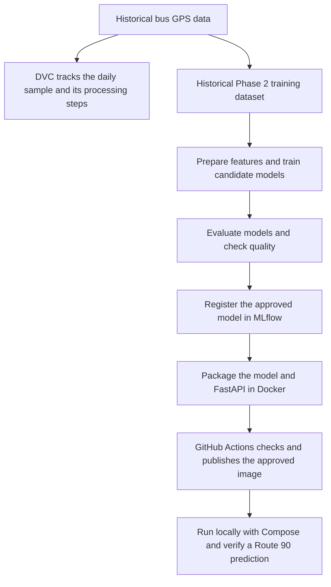
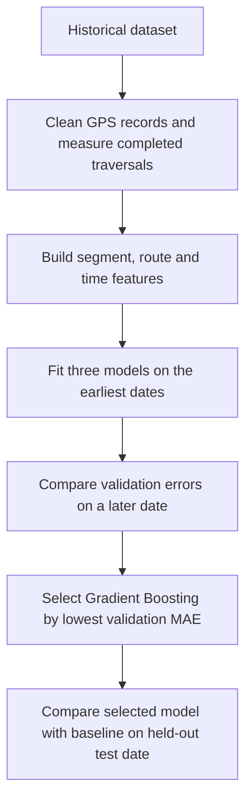
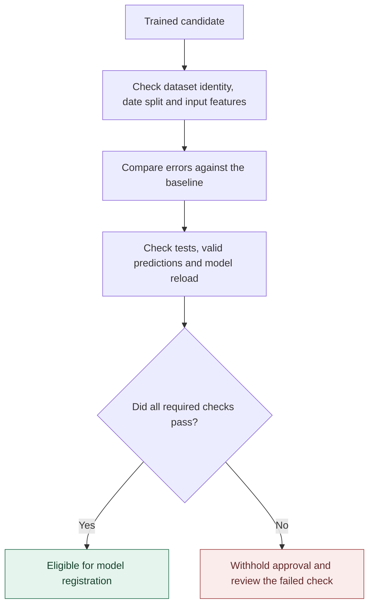
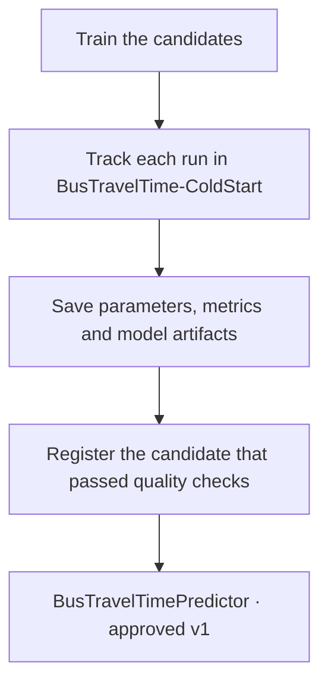
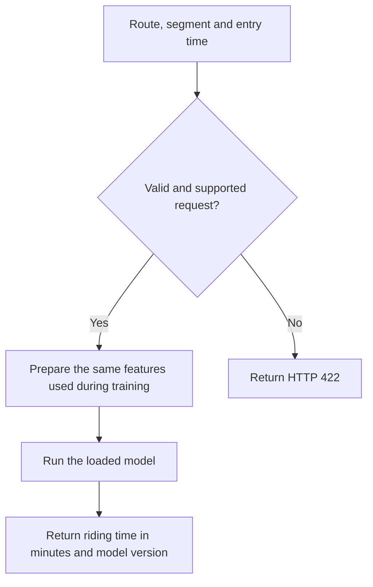
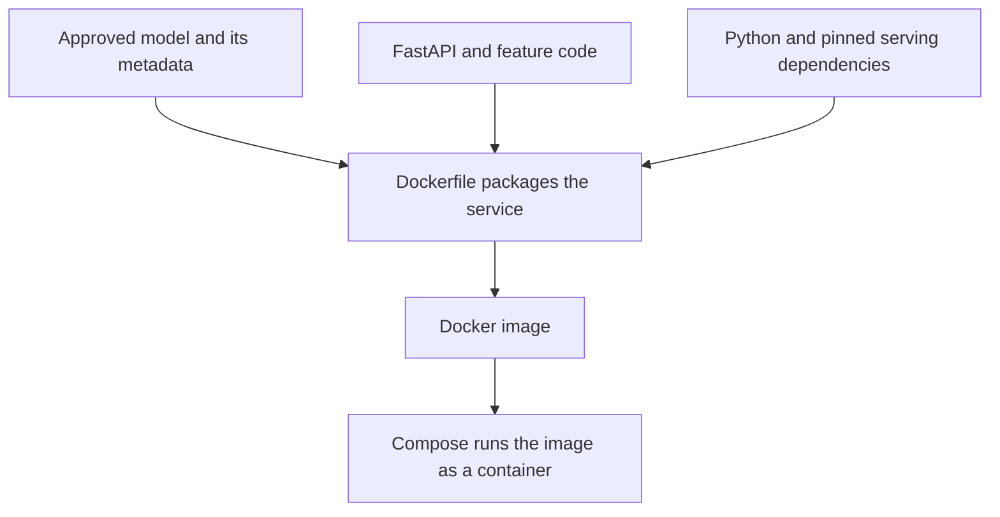
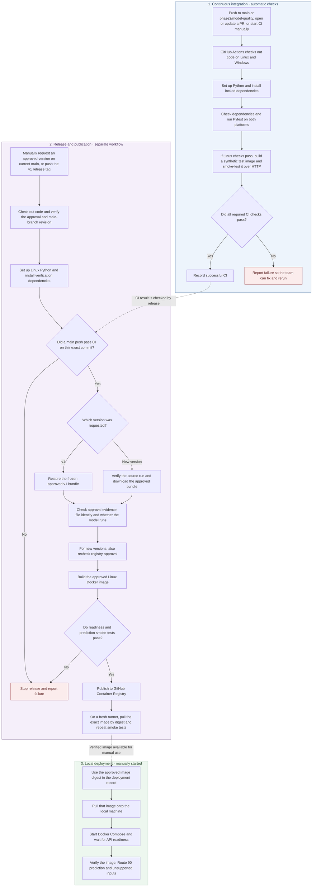
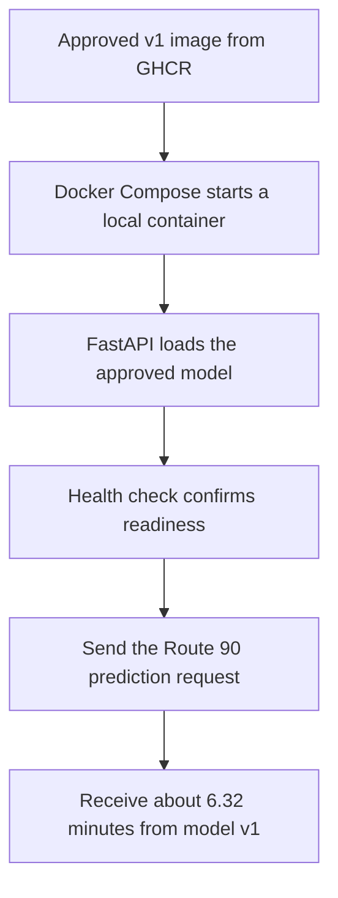

# AI-Powered Sustainable Transportation Advisor

**Phase 2 faculty demonstration · From historical bus GPS data to a working prediction API**

Bus riding times vary by route, segment and time of day. We used historical Delhi bus GPS observations to train and deploy a model that estimates riding time for one approved Route 90 segment.



**Why DVC?** It records which data and processing steps produced the reproducible daily sample. The historical training dataset follows the separate branch in the diagram. [DVC pipeline](../dvc.yaml)

## 1. Model Testing



- **Historical Median** uses typical training-set riding times for each segment. **Random Forest** averages predictions from many trees. **Gradient Boosting** builds trees in sequence to reduce prediction errors.
- **Why scikit-learn?** It lets us fit and compare models under the same feature and evaluation setup. Gradient Boosting narrowly led Random Forest on validation MAE and beat the median on the overall test and approved segment.
- **How to read the scores.** MAE is the average error in minutes. RMSE gives larger errors more weight. MAPE is the average absolute error as a percentage of actual riding time. Lower is better for these three. R² measures how much variation the model explains relative to predicting the mean. Closer to 1 is better.

| Evaluation set | Model | MAE (min) | RMSE (min) | MAPE | R² |
|---|---|---:|---:|---:|---:|
| Validation · 102 traversals | Historical Median | 3.24 | 4.37 | 26.12% | 0.039 |
| Validation · 102 traversals | Random Forest | 2.49 | 3.72 | 19.33% | 0.304 |
| Validation · 102 traversals | **Gradient Boosting** | **2.47** | **3.69** | **19.23%** | **0.315** |
| Overall test · 127 traversals | Historical Median | 4.27 | 6.94 | 27.49% | 0.043 |
| Overall test · 127 traversals | **Gradient Boosting** | **3.62** | **6.32** | **22.04%** | **0.205** |
| Route 90 eastbound · 36 test traversals | **Gradient Boosting** | **1.17** | **1.60** | **15.00%** | **0.340** |

The Route 90 rows are a subset of the overall test set. The recorded final test compares the selected model with the median baseline. [Original quality report](results/phase2-v1/quality_report.json) · [Training code](../src/models/train_cold_start.py)

## 2. Model Risk and Quality Checks



- **Data quality.** Remove duplicate GPS observations and reject implausible jumps or traversals with unsuitable gaps or durations.
- **Leakage prevention.** Fit on earlier dates and test on later dates. At prediction time, the bus has just entered the segment, so the feature set excludes its eventual exit time and riding duration.
- **`cold_start_v1`.** With no live traversal history, use a fixed duration based on segment length and an assumed speed of 22 km/h, with zero completed traversals in the history. Training and serving use the same rule.
- **Why quality gates and Pytest?** The gates require the candidate to beat the median and still give valid predictions after reloading. Pytest checks software behavior, including feature handling and API responses. The original v1 approval recorded **12 passing quality checks**.

[GPS cleaning](../src/data/cleaner.py) · [Shared feature code](../src/features/build_features.py) · [Quality checks](../src/models/check_quality.py)

## 3. MLflow Model Registry



- **Why MLflow?** Tracking lets us compare experiments. The registry gives the approved model a version and links it to the original training run.
- **Our registered model.** `BusTravelTimePredictor` **v1** is the Gradient Boosting model from the `BusTravelTime-ColdStart` experiment.
- **What to show.** Open the separate `Phase2-ML-Artifacts` run in the recovered dashboard at `http://127.0.0.1:5001` to see the daily sample and lineage, preprocessing and feature code, model files, evaluation results, training metric history and deployment evidence. The registered model includes `MLmodel`, `model.pkl` and a saved input example.

[Approved registration record](results/phase2-v1/registration.json) · [Registration code](../src/models/register_checked_model.py)

## 4. FastAPI Inference Service



- **Why FastAPI?** It makes the model callable over HTTP. Pydantic checks request fields, and Swagger UI at `/docs` lets us try the API from a browser.
- **`GET /health`** reports readiness and model identity. **`POST /predict/bus`** takes a route, segment and timezone-aware entry time and returns an estimate.

**Try this verified request in Swagger UI.**

```json
{
  "route_id": "90",
  "segment_id": "ORR_CHIRAG_TO_NEHRU_PLACE_EB",
  "entry_at": "2019-07-08T17:10:00+05:30"
}
```

**HTTP 200** · `duration_minutes: 6.320402254818158` · `model_version: 1` · `history_policy: cold_start_v1`

[FastAPI source](../src/api/main.py) · [Faculty demo steps](phase2_demo.md)

## 5. Docker Containerization



- **Dockerfile.** The recipe for packaging the model, API and dependencies. A **Docker image** is the resulting package. A **container** is a running instance of that package.
- **Why Docker?** Compatible laptops run the same packaged dependencies and approved model. The running API loads the model from the image.
- **Why Compose?** It records which approved image to run and how to expose the local API port.

[Dockerfile](../Dockerfile) · [Compose file](../deploy/compose.yml)

## 6. CI/CD Pipeline



- **Why GitHub Actions?** A change to input validation can be checked automatically on Windows and Linux. Linux also checks that a synthetic test image can serve requests. Its **6.25-minute** fixture response checks the service wiring.
- **Why GitHub Container Registry (GHCR)?** It stores the real approved image so we can pull the exact verified build. The release workflow checks the approved bundle and its prediction before publishing. Earlier release checks also stop the workflow if they fail.
- An ordinary push to a CI branch runs checks. Publication needs a separate release trigger, and local deployment is started manually. The linked v1 run shows the recorded publication. The newer-version path in the diagram describes the configured workflow.

[CI workflow](../.github/workflows/ci.yml) · [Release workflow](../.github/workflows/release.yml) · [Successful Windows/Linux CI](https://github.com/vedanth-04/AI-Powered-Sustainable-Transportation-Advisor/actions/runs/42650967638) · [Successful v1 publication and verification](https://github.com/vedanth-04/AI-Powered-Sustainable-Transportation-Advisor/actions/runs/42330318360)

## 7. Deployment



- **Where it ran.** Docker Compose served the approved image at `http://127.0.0.1:8001` for the local demonstration.
- **Why verify after deployment?** A running container alone cannot confirm which model it serves. Our **8/8 passing checks** covered image identity, container health, model version, the real **6.32-minute** prediction and HTTP 422 for unsupported inputs.

[Approved image record](../deploy/model-v1.json) · [Deployment script](../scripts/deploy_api.py) · [Verification script](../scripts/verify_deployment.py)

## 8. Final Results and Achievements

| What we demonstrated | Recorded result |
|---|---|
| Model selection | Gradient Boosting, registered in MLflow as `BusTravelTimePredictor` v1 |
| Model evaluation | **2.47 min** validation MAE, **3.62 min** overall test MAE, **1.17 min** approved-segment test MAE |
| Automated testing | **29 passed** at original approval. Later Windows and Linux CI recorded **163 passed and 2 skipped** per platform |
| Image delivery | GitHub Actions published and verified the approved v1 image |
| Local inference | Healthy Docker container, **8/8** deployment checks and a **6.32-minute** Route 90 prediction through FastAPI |

## 9. Limitations and Future Scope

- **Coverage today.** Route 90 eastbound on the Chirag Delhi–Nehru Place segment, using historical July 2019 data. The daily DVC sample is available, while the complete original multi-day training input is unavailable locally.
- **Next steps.** Evaluate newer data and the remaining configured segments before widening coverage. Live traffic, public hosting and the broader multimodal advisor with fares, emissions and a journey interface remain future work.
