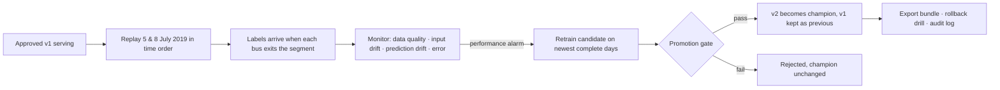

# AI-Powered Sustainable Transportation Advisor

**Phase 3 faculty demonstration · Productionization & Deployment**

In Phase 2 we deployed an approved bus riding-time model (v1). Phase 3 asks: what happens *after* deployment? We replay unseen days through the model, detect drift, retrain when it matters, version every model, and show the whole pipeline on one dashboard under explicit governance.

> **About the numbers.** All figures come from the release-environment run of 21 November 2026: the approved v1 artifact (sha256 `b26d1a45…`), Python 3.12.14 and scikit-learn 1.5.2. The committed record is [`docs/results/phase3/phase3_summary.json`](results/phase3/phase3_summary.json).

## 1. Data / model drift: induce it, detect it, monitor it

**How we monitor.** The model predicts when a bus *enters* a segment. The true duration is known only when it *exits*, so performance is measured on delayed labels, exactly as in production.

| Layer | What it catches | Method |
|---|---|---|
| Data quality | Broken feeds | Every request validated (registered route, service hours, clock skew). Alert when >5% of the last 20 fail |
| Input drift | Request mix changes | PSI per feature vs the *same time of day* on the training days; KS test for numeric features |
| Prediction drift | Output distribution changes | PSI on predicted minutes |
| Performance (model drift) | The world changed, inputs did not | Error ÷ expected error for that segment and time of day; one-sided **CUSUM** per segment |

**Thresholds are calibrated, not guessed.** Windows hold 15–60 requests, so textbook cut-offs (PSI > 0.25) would raise false alarms. Each threshold is the 95th/99th percentile of the statistic on same-sized resamples of in-control data. The CUSUM threshold allows at most 5% false alarms across all detectors. On the reference day (5 July) the monitor raised **no alerts**, only the occasional warning expected at a 5% false-warning rate.

**What we induced and what was detected** (delay = time from the first affected request to the first alert):

| Scenario | What we changed | First alert | Delay |
|---|---|---|---|
| Natural replay | Nothing | CUSUM on **MB Road westbound**, 8 Jul 15:33 | — (real drift) |
| Data drift: demand shift | From 8 Jul, request mix shifts to ORR eastbound | Input drift (segment/route PSI 0.67 vs threshold 0.57), 10:44 | ~5 h (judged when the morning-rush window closes) |
| Model drift: road works | From 8 Jul 10:00, ORR eastbound riding time ×1.6 | CUSUM on ORR eastbound, 10:58 | **49 min** |
| Data-quality fault | From 8 Jul 12:00, 40% of timestamps sent in UTC as IST, 10% unknown route | Rolling data-quality alert, 12:18 | **12 min** |

Three findings matter most:

- **Road works were invisible to input-drift checks.** The inputs did not change, only reality did. Only label-based monitoring caught it.
- **The demand shift raised input-drift alerts while overall error *fell*** (MAE 1.79 vs 3.62 min) and no performance alert fired, because more requests came from the segment the model predicts best. Drift is a signal, not proof of failure, so input drift alone never triggers retraining.
- **We found genuine drift we did not inject.** On Monday 8 July the model under-predicts Mehrauli–Badarpur westbound by about 6.5 minutes (MAE 6.55 vs 3.40 on 5 July). Monitoring per segment exposed it; the overall average hid it.

[Monitoring code](../src/monitoring) · [Monitoring policy](../config/phase3/monitoring_policy.json)

## 2. Model versioning, and why we version

| Version | Why it exists | Trained on | Holdout MAE (8 Jul) | Status |
|---|---|---|---:|---|
| **v1** | Phase 2 approved release, imported by artifact hash | 1–3 Jul | 3.62 | approved → `previous` |
| **v2** | Retrained after the real performance alarm. Same algorithm, features and hyperparameters; **new data window** | 1–5 Jul | **3.39 (−6.5%)** | approved → `champion` |
| **v3** | Retrain attempted on a batch hit by the timezone fault | 1–5 Jul (corrupted) | 3.56 | **rejected**: data validation failed, 5% worse than v2, ORR eastbound +17% |

**Why version models?**

- **Traceability:** each version records data rows hash, code commit, hyperparameters, feature-schema hash, runtime and artifact hash, so any prediction can be traced back.
- **Safe change:** retraining makes a *candidate*. Only versions that pass the gate can be served.
- **Rollback:** `previous` always points at the last good version. A real drill rolled back v2 → v1, verified the hash, reproduced the Phase 2 release prediction exactly (6.3204 min), and restored v2.
- **Comparison:** all versions are scored on the same holdout, so "better" is reproducible.
- **Accountability:** every action is in a hash-chained audit log with the actor's name.

**Promotion gate (v2 passed all 7):** data validation · valid predictions · ≥3% better than champion · beats median baseline · no segment worse by >10% · same feature schema as the API · identical predictions after save/reload.

All three versions are registered in a separate Phase 3 MLflow registry with `champion` and `previous` aliases (open it with `mlflow ui`; the command is on the dashboard's Model registry page). The Phase 2 registry and live v1 are untouched.

[Version ledger code](../src/versioning/ledger.py) · [Promotion policy](../config/phase3/promotion_policy.json) · [Lifecycle](../src/versioning/lifecycle.py)

## 3. Complete dashboard with the whole MLOps pipeline

A **React** single-page app (Vite, hand-built SVG charts, light/dark themes) talks to a small Python API that reads every pipeline artifact. `python -m dashboard.server` serves both at `http://127.0.0.1:8050`. Eight pages:

| Page | Shows |
|---|---|
| Overview | Hero summary, six KPIs, pipeline health strip, time-to-first-alert, error by segment and version |
| Pipeline | 11-stage pipeline graph with live status from real artifacts: data → DVC → labels → training → quality gate → registry → CI → deploy → monitor → retrain → rollback |
| Data | Traversals per day and segment, riding-time distribution, archive hashes, DVC stages |
| Experiments | Phase 2 model comparison and the 12 quality checks |
| Model versions | Ledger, aliases, gate checks, version diff, MAE by segment per version, audit log with chain check |
| Drift monitoring | Scenario switcher, window status grid, error timeline, CUSUM chart, PSI by feature, alerts, runbook actions |
| Deployment | Release digest, exported v2 bundle, live health/latency probe of the API, every version's prediction side by side |
| Governance | Controls with evidence status, governance policy, model card, policies in force |

## 4. Governance and its justification

The model is **advisory** (a person chooses the journey), uses **no personal data**, and errors cost minutes, not safety. So we use proportionate controls focused on traceability, fairness across corridors and fast recovery. We chose not to add heavy approval boards.

| Area | Control | Justification |
|---|---|---|
| Data | Validate before every retrain; quarantine bad batches | The source archive documents timezone corrections; our replay shows the damage |
| Model | Gate + "no segment worse by >10%" | A better average must not hide a worse corridor (fairness) |
| Deployment | Digest-pinned images; human approval to publish | Exactly what was approved runs; automation never silently changes what users see |
| Monitoring | Calibrated thresholds; per-segment detectors; runbook | Small windows need calibration; averages hide failures |
| Accountability | Named roles; actor on every change; tamper-evident log | Model owner cannot approve their own release |
| Privacy | No vehicle IDs in features or dashboard; no request bodies logged | Avoids driver monitoring; ready for DPDP obligations once trip requests are live |

The controls map to the seven principles of MeitY's India AI Governance Guidelines (Nov 2025). [Full governance policy](PHASE3_GOVERNANCE.md) · [Model card](MODEL_CARD.md)

## Limitations we state openly

A two-day historical replay is not live monitoring. One validation day is a small reference. The v2 improvement is real but modest: the model still under-predicts busy days because it has no live traffic signal. That is the natural next step.
