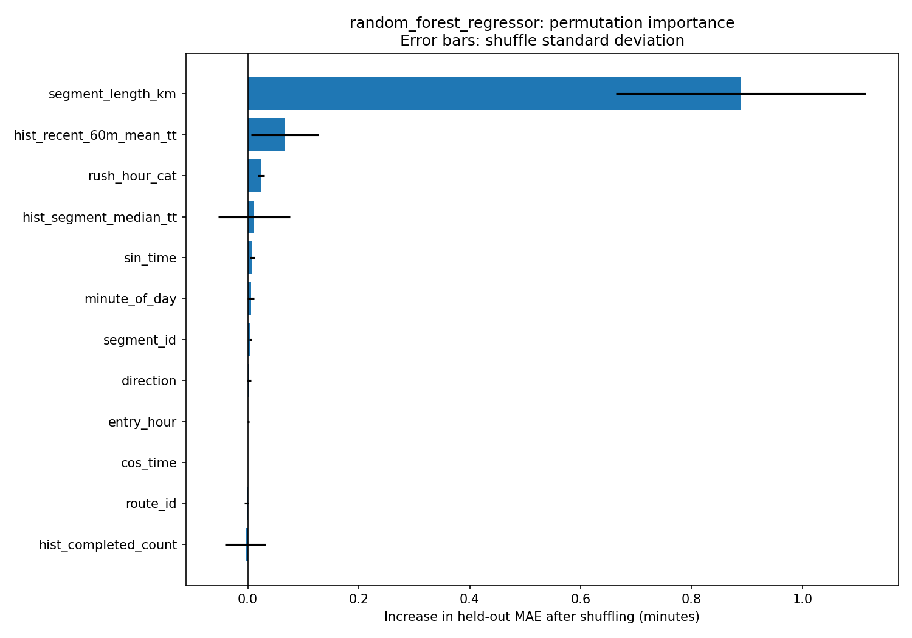

# Corrected model feature-importance results

Measured on 16 October 2026 using code commit `84ac497` and the verified July 1, 2019 database (1,977,922 raw observations). The database passed CRC32 and SQLite integrity checks. The existing label pipeline reproduced 152 journeys across four segments and 57 buses. Model settings and the 75/25 chronological split were unchanged: 114 training journeys, 38 test journeys. There are 12 inputs; completed-journey speed is excluded.

## Corrected performance

| Model | Test MAE (minutes) | Test RMSE (minutes) |
|---|---:|---:|
| Random Forest | 1.8694 | 2.6496 |
| Gradient Boosting | 1.9427 | 2.8247 |
| Historical Median | 2.4412 | 3.3917 |

Random Forest has the lowest test MAE in this comparison. Its average absolute error is about 1 minute 52 seconds. Earlier published scores used a target-derived speed feature and are superseded by this run. This comparison does not isolate every environmental difference: the installed scikit-learn is 1.4.2, below requirements.txt's >=1.5.0. See provenance.json for runtime versions and data hashes.

## Which inputs mattered?

Permutation importance shuffles one original input column at a time on the held-out test rows. Values are increases in mean absolute error, in minutes, averaged over 20 shuffles with seed 42. Larger positive values mean more model reliance. Standard deviations describe variation across shuffles, not statistical confidence intervals.

| Random Forest input | MAE increase (minutes) | Shuffle standard deviation |
|---|---:|---:|
| segment_length_km | 0.8890 | 0.2253 |
| hist_recent_60m_mean_tt | 0.0667 | 0.0609 |
| rush_hour_cat | 0.0242 | 0.0059 |
| hist_segment_median_tt | 0.0111 | 0.0644 |
| sin_time | 0.0081 | 0.0049 |
| minute_of_day | 0.0056 | 0.0060 |
| segment_id | 0.0048 | 0.0021 |
| direction | 0.0017 | 0.0037 |
| entry_hour | 0.0008 | 0.0019 |
| cos_time | -0.0000 | 0.0000 |
| route_id | -0.0022 | 0.0034 |
| hist_completed_count | -0.0043 | 0.0367 |



Segment length is clearly the strongest individual input for both tree models in this evaluation (Random Forest: +0.889 minutes; Gradient Boosting: +1.157 minutes). Recent-hour average travel time is second in both rankings, but its effect is small and variable. Other inputs have weak individual effects on this sample; zero/negative importance does not establish that they are useless.

## Interpretation limits

- Only one day, four sections, two distinct section lengths, and 38 test journeys are represented. Length may identify corridor-specific differences rather than a general distance effect.
- Related inputs (segment, route, direction, length, and multiple time encodings) share information. Shuffling a single input can create unrealistic combinations and can mask shared importance. Rankings are not causal effects.
- Historical inputs simulate an online system: completed earlier test journeys can update history for later predictions. No journey contributes its own outcome or a not-yet-completed journey's outcome. This is not a fixed, all-day forecast made before test observations arrive.
- These test-set diagnostics were not used to change inputs or tune models. Feature selection requires separate chronological validation periods and ideally more days.
- No inputs were dropped based on these rankings. No additional approach-speed feature was introduced.

## Reproduce

```powershell
python src/data/download_sample.py
python -m src.features.build_labels
python -c "import pandas as pd; from src.features.build_features import engineer_features; engineer_features(pd.read_csv('data/processed/traversals.csv')).to_csv('data/processed/features.csv', index=False)"
python -m src.models.train
```

Tables and plots in this directory are copies of the generated outputs. Model binaries, raw data, and local MLflow runs remain excluded from Git.
